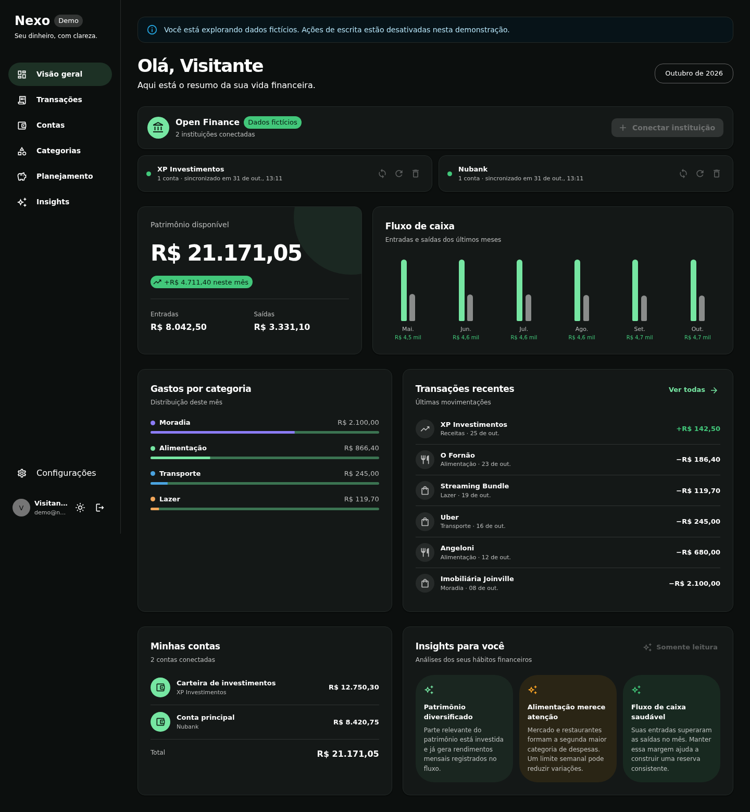
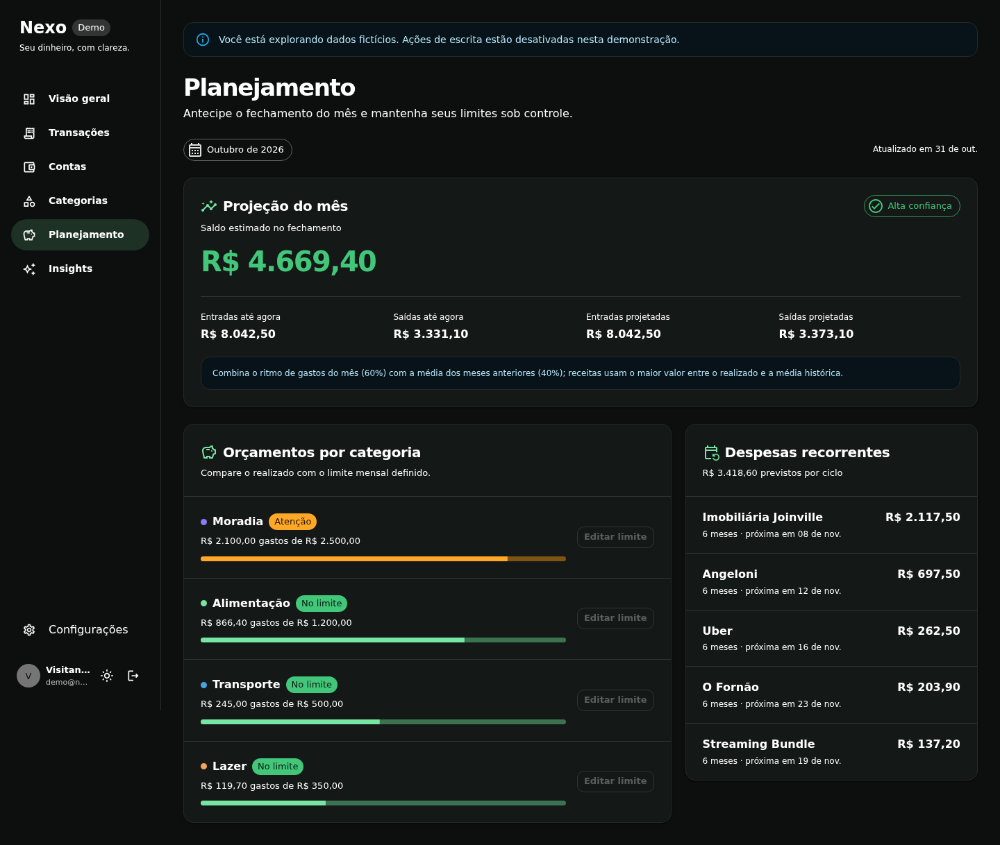
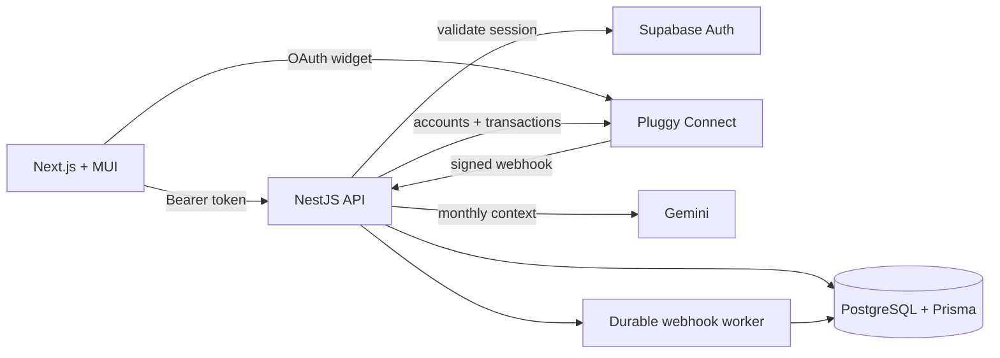

# Nexo

[](https://github.com/marosleo/financial-dashboard-sass/actions/workflows/ci.yml)


Dashboard financeiro full stack que transforma dados de Open Finance em uma
visão clara do presente e em decisões para o próximo mês. O Nexo conecta contas
brasileiras via Pluggy, consolida transações e usa IA para explicar padrões de
consumo — sem reduzir o produto a um chatbot genérico.

> Projeto de portfólio construído como um produto real: autenticação,
> isolamento por usuário, integrações externas, processamento assíncrono,
> observabilidade, testes de navegador e imagens de produção independentes.

[Case study](./docs/case-study.md) · [Arquitetura](./docs/architecture.md) ·
[Deploy](./docs/deployment.md) · [Segurança](./SECURITY.md)

## Produto



O fluxo principal vai da conexão bancária à decisão financeira:

1. O usuário entra com Supabase Auth e conecta uma instituição pelo Pluggy.
2. A API sincroniza contas e transações de forma idempotente.
3. O dashboard consolida patrimônio, fluxo mensal, categorias e histórico.
4. Correções de categoria viram regras reutilizadas nas próximas sincronizações.
5. O planejamento estima o fechamento, acompanha orçamentos e identifica
   despesas recorrentes.
6. O Gemini produz insights contextuais; uma análise determinística mantém o
   produto útil quando o provedor está indisponível.



## Diferenciais técnicos

- **Open Finance real:** widget OAuth da Pluggy, sincronização incremental,
  webhooks autenticados e proteção contra eventos duplicados.
- **Feedback que melhora o produto:** categorias corrigidas pelo usuário geram
  regras por estabelecimento e não são sobrescritas pelo provedor.
- **Planejamento explicável:** projeção pondera ritmo atual e média histórica,
  expõe confiança e não apresenta estimativas como certezas.
- **Processamento durável:** webhooks ficam no PostgreSQL antes do `202
Accepted`, com claim atômico, recuperação de locks, backoff e dead letter.
- **Operação observável:** request IDs, logs estruturados, liveness e readiness
  com estado do banco e da fila.
- **Demo segura:** experiência pública somente leitura com dados fictícios e
  bloqueio de escrita também na API.
- **Qualidade reproduzível:** lint, tipos, unit tests, auditoria, build e uma
  matriz Playwright em CI, cobrindo desktop e mobile.

## Arquitetura



| Camada    | Tecnologia                                 | Responsabilidade                              |
| --------- | ------------------------------------------ | --------------------------------------------- |
| Web       | Next.js App Router, React, TypeScript, MUI | Experiência responsiva, sessão e visualização |
| API       | NestJS, TypeScript                         | Domínio, autorização, integrações e worker    |
| Dados     | PostgreSQL, Prisma                         | Isolamento, regras, budgets e fila durável    |
| Auth      | Supabase Auth                              | Cadastro, login, recuperação e tokens         |
| Finance   | Pluggy SDK                                 | Open Finance, consentimento e sincronização   |
| IA        | Gemini                                     | Resumos financeiros contextuais               |
| Qualidade | Node Test, Playwright, GitHub Actions      | Regressão, build e segurança de dependências  |

## Executar localmente

Requisitos: Node.js 22+, Docker e Docker Compose.

```bash
git clone git@github.com:marosleo/financial-dashboard-sass.git
cd financial-dashboard-sass
cp .env.example .env
npm ci
npm run setup
npm run dev
```

Acesse `http://localhost:3002`. Com `DEMO_MODE_ENABLED="true"`, use **Explorar
demonstração** para navegar sem credenciais externas. A API roda em
`http://localhost:3001` e o PostgreSQL local na porta `5433`.

Para habilitar integrações reais, preencha no `.env` as chaves publicáveis do
Supabase, as credenciais do Pluggy e, opcionalmente, a chave do Gemini. Nunca use
`service_role`, tokens privados ou dados bancários em arquivos versionados.

## Comandos úteis

```bash
npm run dev                # web + API + PostgreSQL
npm run setup              # migrations, seed e contratos compartilhados
npm run lint               # lint em todos os workspaces
npm run typecheck          # TypeScript em todos os workspaces
npm test                   # testes unitários
npm run test:e2e           # fluxos desktop e mobile no Chromium
npm run build              # build de produção
npm run portfolio:capture  # atualiza screenshots com a demo local ativa
```

## Estrutura

```text
apps/
├── web/          Next.js, páginas e componentes
└── api/          NestJS, domínio, integrações e worker
packages/
└── shared/       contratos TypeScript compartilhados
prisma/           schema, migrações e seed idempotente
e2e/              jornadas Playwright isoladas
docs/             arquitetura, case study e deploy
```

## Deploy e estado do projeto

Web e API possuem Dockerfiles multi-stage independentes, executam com usuários
sem privilégios e têm health checks. O processo de produção aplica apenas
migrações versionadas; a estratégia de rollback e todas as variáveis estão em
[docs/deployment.md](./docs/deployment.md).

O repositório está pronto para deploy em uma plataforma de containers. A URL
pública não faz parte do repositório porque depende da conta e do custo do
provedor escolhido. Até lá, a demo local reproduz a experiência sem serviços
pagos nem dados reais.

## Decisões para discutir em entrevista

- Por que uma fila no PostgreSQL é adequada agora e quando migrar para SQS ou
  BullMQ.
- Como `AsyncLocalStorage` mantém o usuário autenticado disponível sem acoplar
  o domínio ao framework HTTP.
- Como idempotência, constraints únicas e ownership evitam duplicidade e acesso
  cruzado a dados financeiros.
- Por que projeções mostram metodologia e confiança em vez de uma falsa
  precisão.
- Como a demo é protegida no backend, não apenas escondida na interface.

O raciocínio completo, limites e próximos passos estão no
[case study](./docs/case-study.md).
