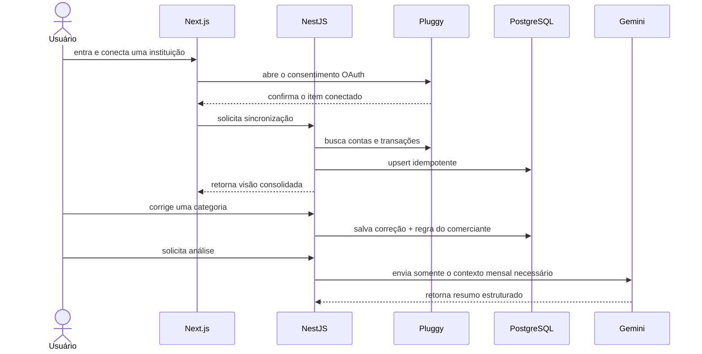

# Nexo — case study de produto e engenharia

## Resumo

O Nexo é um dashboard financeiro para pessoas que possuem dinheiro distribuído
entre instituições e querem entender não apenas o que aconteceu, mas como o mês
deve terminar. Ele consolida dados de Open Finance, aprende com correções do
usuário, identifica compromissos recorrentes e transforma transações em uma
explicação acionável.

Este projeto foi desenvolvido como portfólio e exercício de engenharia full
stack. O objetivo não era criar mais uma tela de gráficos, e sim demonstrar as
decisões necessárias para operar um produto que lida com dados financeiros e
provedores externos.

## Problema

Aplicativos bancários apresentam uma visão fragmentada e retrospectiva. Mesmo
quando categorizam compras, o usuário ainda precisa responder manualmente:

- quanto realmente pode gastar até o fim do mês;
- quais despesas voltarão a acontecer;
- quais categorias estão próximas do limite;
- por que o comportamento mudou em relação aos meses anteriores.

A hipótese do Nexo é que a combinação de agregação confiável, projeções
explicáveis e texto contextual reduz o esforço para chegar a essas respostas.

## Escopo do produto

### Entregue

- autenticação e recuperação de acesso com Supabase;
- conexão e atualização de consentimento pelo Pluggy Connect;
- sincronização idempotente de contas e transações;
- dashboard, histórico pesquisável, categorias e insights;
- correção de categoria com regra persistida por estabelecimento;
- orçamentos mensais, recorrências e projeção do fechamento;
- demo pública somente leitura com seed idempotente;
- fila durável para webhooks, observabilidade e containers de produção;
- testes unitários, E2E desktop/mobile e CI.

### Fora do escopo atual

- iniciar pagamentos ou movimentar dinheiro;
- aconselhamento de investimento;
- compartilhar uma conta entre diferentes usuários;
- prometer previsão estatística sem histórico suficiente;
- hospedar uma URL pública sem que o proprietário escolha custos e provedor.

## Jornada principal



## Decisões de engenharia

| Decisão                                            | Motivo                                                  | Trade-off                                                   |
| -------------------------------------------------- | ------------------------------------------------------- | ----------------------------------------------------------- |
| Monorepo com contratos compartilhados              | Evita divergência entre DTOs da API e tipos da web      | Exige ordem de build explícita                              |
| Supabase valida a identidade; API valida ownership | O token sozinho não autoriza acesso a qualquer recurso  | Uma consulta externa de sessão por request aumenta latência |
| Constraints únicas + upsert para dados Pluggy      | Webhooks e sincronizações podem ser reenviados          | Mapeamento precisa preservar correções humanas              |
| Regra determinística antes de IA na categorização  | Feedback do usuário é barato, previsível e auditável    | Não resolve comerciantes nunca vistos                       |
| Projeção ponderada e confiança visível             | É explicável e funciona com pouco histórico             | Não substitui um modelo estatístico em grande escala        |
| Fila no PostgreSQL                                 | Durabilidade sem Redis/SQS e sem novo custo operacional | Polling e throughput limitado em alto volume                |
| Fallback local para insights                       | Mantém o produto útil durante falha do Gemini           | Texto é menos personalizado                                 |
| Demo bloqueada na API                              | Segurança não depende do estado visual do botão         | Requer allowlist explícita de rotas GET                     |

## Confiabilidade da integração

O endpoint de webhook valida um segredo com comparação em tempo constante e só
responde `202 Accepted` depois que o evento foi persistido. O worker:

1. seleciona eventos pendentes ou locks abandonados;
2. usa um update condicional para que apenas uma instância faça o claim;
3. incrementa a tentativa antes do processamento;
4. agenda retry com backoff exponencial limitado;
5. marca como falha definitiva depois de cinco tentativas.

IDs únicos de evento, item, conta e transação tornam reenvios seguros. A fila
expõe contadores e idade da pendência no endpoint de readiness.

## Segurança e privacidade

- Toda consulta de domínio inclui o `userId` resolvido da sessão autenticada.
- O backend verifica que itens Pluggy pertencem ao usuário antes de sincronizar.
- Segredos ficam apenas no runtime da API; variáveis `NEXT_PUBLIC_*` são as
  únicas incorporadas ao bundle do navegador.
- A análise envia ao Gemini apenas o recorte necessário para produzir o resumo.
- Logs não incluem bearer tokens, payloads financeiros ou credenciais.
- Screenshots e demo usam dados sintéticos.
- Imagens Docker executam sem root e dependências de produção são auditadas.

## Observabilidade

Cada request recebe um `X-Request-Id` sanitizado e gera um log estruturado com
método, rota, status e duração. O Nexo separa:

- `/api/health`: liveness barata, sem dependências;
- `/api/health/ready`: banco acessível e estado da fila de webhooks.

Essa separação evita reiniciar uma aplicação saudável por uma indisponibilidade
temporária do banco, ao mesmo tempo em que impede tráfego para uma instância que
não está pronta.

## Estratégia de testes

```text
Funções puras       → mapper Pluggy, merchant key, recorrência e projeção
Serviços            → fallback e parsing estruturado dos insights
Infra de domínio    → claim da fila, backoff e request IDs
Browser E2E         → login, demo, dashboard, edição e navegação responsiva
Build/containers    → TypeScript, Next.js, NestJS, migrations e healthcheck
```

O Playwright intercepta apenas APIs nos testes de interface para que a suíte não
dependa de Supabase, Pluggy ou Gemini. A persistência e a imagem final são
validadas separadamente contra PostgreSQL real. Isso mantém feedback rápido sem
confundir teste de UI com teste de provedor externo.

## Desafios e aprendizados

### Não sobrescrever a intenção do usuário

Uma sincronização posterior poderia restaurar a categoria recebida do banco.
Para evitar isso, cada transação registra a origem da categoria (`PROVIDER`,
`RULE`, `USER` ou `AI`) e o upsert preserva escolhas humanas.

### Tratar previsão como estimativa

O cálculo combina 60% do ritmo corrente com 40% da média histórica e nunca
projeta menos que o valor já gasto. A confiança depende da quantidade de meses e
do avanço do mês. A metodologia aparece na própria tela.

### Assincronismo que sobrevive a reinícios

`setImmediate` responde rápido, mas perde trabalho se o processo cair. Persistir
antes de responder criou uma garantia clara e tornou retries observáveis, sem
introduzir infraestrutura prematuramente.

## Próximos passos

1. Deploy público após escolha do provedor e configuração dos domínios.
2. Testes de contrato contra sandbox do Pluggy em uma pipeline agendada.
3. Preferências de notificação para orçamento e consentimento próximo de expirar.
4. Avaliação offline da qualidade das categorias sugeridas por IA.
5. Migrar a fila para um serviço gerenciado quando volume, SLA ou múltiplos
   consumidores justificarem.

## Roteiro para entrevista

O desenvolvedor deve conseguir explicar e modificar:

- o caminho completo do token do navegador até o filtro por `userId`;
- a diferença entre idempotência de evento e idempotência de transação;
- a condição de corrida evitada pelo claim atômico da fila;
- por que as categorias têm origem e confiança;
- as limitações matemáticas da projeção atual;
- quais falhas acionam retry, fallback ou erro para o usuário;
- como separar liveness, readiness e monitoramento de negócio;
- o que mudaria para atender dez ou cem vezes mais tráfego.

Esses pontos são mais valiosos em uma conversa técnica do que memorizar detalhes
de framework: demonstram ownership de produto, segurança e operação.
